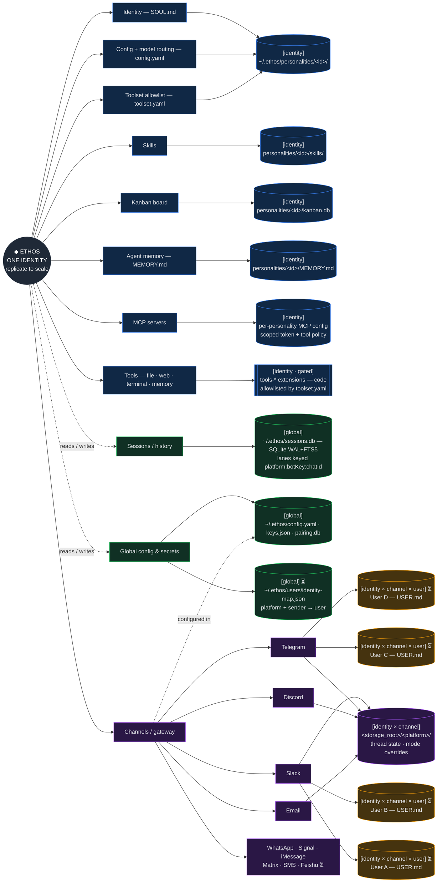

## Context

Most agent frameworks let you set a "persona" by editing the system prompt. You write "you are a careful reviewer", paste it into a string field, and the agent's voice changes. Its tools do not. Its memory does not. Its model does not. The agent is still the same general-purpose engine wearing a different label.

A [personality](../../getting-started/glossary.md#personality) in Ethos is different. It is a directory at `~/.ethos/personalities/<id>/` with three files in it. Switching to it does not just change how the agent talks. It atomically swaps multiple dimensions of the agent's behaviour — prompt, tools, MCP token scope, and model. You cannot "set the reviewer personality but keep the engineer's write tools" — that combination is not expressible.

The rest of this page explains why the unit is a directory, what changes when you switch, and what the design refuses to put inside that directory.

## Parts

| Part | Covers |
|---|---|
| This page | Context, three files, the three dimensions, hot reload, the frozen schema, trade-offs. |
| [Why is personality isolation enforced, not advised?](./what-is-a-personality/isolation-and-switching.md) | Isolation, enforcement at the registry, directory vs database row, what stays across a switch, the cost, learning from usage, schema location. |

## Discussion

### A personality is three files, not a string

The directory contains exactly three load-bearing files. Anything else in it is incidental.

```
~/.ethos/personalities/<id>/
├── SOUL.md        first-person identity — who am I, how do I speak
├── config.yaml     name, description, model, fs_reach, mcp_servers, ...
└── toolset.yaml    flat list of allowed tool names
```

`SOUL.md` is the agent speaking in the first person. Not a description of a persona — the agent itself. "I am a methodical research assistant. I cite primary sources. I flag uncertainty rather than smoothing over it." Loaded as the system prompt baseline.

`config.yaml` is plain `key: value`. It names the personality, declares which model handles its turns, optionally restricts filesystem reach, and optionally allowlists MCP servers and plugins. The full field list is in the [personality config reference](../reference/personality-yaml.md).

`toolset.yaml` is a flat list of [tool](../../getting-started/glossary.md#tool) names. The agent literally cannot call a tool that is not in this list — `DefaultToolRegistry.toDefinitions(allowedTools)` filters what the LLM ever sees, and `executeParallel` rejects calls outside the allowlist. The restriction is not advisory.

A minimal `config.yaml`:

```yaml
name: Reviewer
description: Critical, evidence-based reviewer that raises concerns directly.
model: claude-sonnet-4-6
```

A minimal `toolset.yaml`:

```yaml
- read_file
- search_files
- session_search
```

That is the entire surface for a working personality. The agent reads `SOUL.md` to know who it is, `config.yaml` to know which model and routing, and `toolset.yaml` to know what it can call. Three files in, working agent out.

### The three dimensions that move together

Switching personalities in chat — `/personality engineer` to `/personality reviewer` — changes all of them at once:

| Dimension | What changes | Source of truth |
|---|---|---|
| System prompt | Identity, voice, what the agent is *for* | `SOUL.md` |
| Tool access | Which actions the LLM can request | `toolset.yaml` |
| MCP token scope | Per-personality OAuth tokens and MCP tool policy | `mcp_servers` in `config.yaml`, tokens at `~/.ethos/personalities/<id>/mcp/<name>/access_token` |
| Model routing | Which LLM handles the turn | `model` in `config.yaml` |

You cannot accidentally run the engineer's write-shaped tools under the reviewer's read-only toolset. The reviewer's `toolset.yaml` does not list them. The dimensions are joined at the registry, not at convention. See [Set up MCP for a personality](../how-to/set-up-mcp-for-a-personality.md) for the step-by-step.



The conversation thread does not fork on a switch. The same [session](../../getting-started/glossary.md#session) history is visible to whichever personality is active next. You are one human swapping hats, not two different users opening two different chats.

### Hot-reload, mtime-cached

`FilePersonalityRegistry` re-reads a personality only when one of its three files changes on disk. The loader fingerprints `config.yaml`, `SOUL.md`, and `toolset.yaml` by `mtime`; identical fingerprint means the cached config wins. Calling `loadFromDirectory()` on every turn is cheap when nothing changed and reflects the new content on the next turn when something did.

This is the property that lets you edit `SOUL.md` mid-session, send a follow-up message, and watch the agent's voice change without losing history. The conversation continues; the role updates.

There is one quiet benefit of this design. Tuning a personality is a fast loop — edit, send a message, see the difference, edit again. The cost of iterating on "how should the reviewer phrase findings" is zero process restarts and zero session loss. The personality is a config file, not a stored procedure.

### The schema is frozen

`PersonalityConfig` lives in `packages/types/src/personality.ts` and the field count is mechanically gated. The CI test `packages/types/src/__tests__/personality-field-count.test.ts` parses the interface at test time and fails if the count drifts from `.personality-field-count` at the repo root. Adding a top-level field requires a `personality-schema-change` label, two-maintainer approval, and bumping the count in the same commit.

This is not procedural caution. The schema is the load-bearing surface — it is what defines, end-to-end, what a personality is. Letting it grow uncontrolled would turn the personality directory into a config dump. The friction is there to force a clear answer to a hard question every time the surface expands.

### What does *not* belong on a personality

The categories the schema explicitly refuses:

- Voice modes, VAD tuning, speech parameters, TTS engine settings.
- Emotion, mood, sentiment tags.
- Response templates and label vocabulary.
- Per-channel UI affordances (button labels, card layouts).

Each of these is a real product need; none of them are personality concerns. Response templates belong to skills. UI affordances belong to the surface (web, CLI, Telegram). Voice splits along the same line: *which* voice a personality speaks in is identity and lives in its `voice` block; *when* and *whether* it speaks is the operator's, in `~/.ethos/config.yaml`. Mixing them into the personality directory was the first instinct and has been refused four times — the goal is a tight unit you can reason about, not a god object that accretes every cross-cutting concern.

### The first-person voice in `SOUL.md`

A common pattern in prompt engineering is the third-person description: "You are a careful reviewer who asks for evidence." It works, but it produces an agent that can be reasoned out of its role — "actually, just for this turn, do not ask for evidence". The third-person framing is advice; the model can argue with it.

`SOUL.md` is written in the first person. The agent is not described to itself; the agent speaks as itself. "I am a methodical research assistant. I cite primary sources. I flag uncertainty rather than smoothing over it." The grammatical shape changes the failure mode: the agent is more reluctant to drop its identity mid-turn because it would have to switch grammatical persons to do so.

Keep `SOUL.md` opinionated. A vague identity produces vague behaviour. "I am a critical, evidence-based reviewer" gives the model a stronger anchor than "I review code carefully". Be concrete about what the role refuses to do; the refusals are how a personality stays itself when a user asks it to be something else.

## Trade-offs

**You give up the "one super-agent with knobs" mental model.** Every distinct role is a directory you commit to. Three user-facing roles is three directories, three `SOUL.md` files, three toolsets. The alternative — one agent with a `mode` field and per-mode tool filters — was rejected because the resulting code path is one big branch on the mode flag and the boundaries leak.

**You give up cross-personality memory entirely.** Memory is always per-personality — the reviewer cannot see the engineer's notes. This is the point — opinions about what was reviewed should not leak into what gets built. If you need cross-personality context, read the other personality's `MEMORY.md` directly or wire a shared backend via the `MemoryProvider` interface.

**You give up a single configuration surface.** A personality is a directory of three files, not a YAML field in one config. Three user-facing personalities is nine files. The trade is legibility for compactness: a `cat ~/.ethos/personalities/reviewer/SOUL.md` is a complete answer to "what is the reviewer", and that answer survives `grep`, `diff`, and code review.

**You cannot pick a model per turn.** A personality declares one model. If you want Opus on planning and Sonnet on writing, that is two personalities (`researcher` is Opus, `engineer` is Sonnet) that you switch between, not a knob inside one. The atomic-swap rule makes that legible.

**You pay a small cost on every turn.** The mtime-fingerprinted reload is cheap, but it is not zero. Three `stat` calls per personality per turn. For a registry with twenty personalities, that is sixty stat calls before the model is even asked. On a fast filesystem this is negligible; on a network filesystem it is measurable. The trade is the live-edit story: tuning a personality without restarting beats process restart costs by a large margin.

Alternatives considered:

- A single `personality.yaml` with a `mode` field. Rejected: the dimensions had to move together, and a single config that branches on a mode field is a god object the schema cannot defend.
- Personality as a function in code. Rejected: defeats hot-reload, defeats version control of identity, defeats the "team shares a reviewer" workflow.
- Personality as a row in SQLite. Rejected: not readable, not greppable, requires a migration to add a field, no `diff` story.
- Tool access as a separate file unrelated to the personality. Rejected: the atomic-swap property is the headline. Joining tool access to the personality at the directory level keeps the dimensions visibly coupled; splitting them invites drift where a personality "is" a reviewer but "can" write.
- A merge model where personality overlays change a base personality. Rejected as overengineering for v1. Three user-facing built-ins plus duplicate-and-edit is enough; overlays add a layer that obscures what a personality actually is.

## See also

- [What are the built-in personalities?](built-in-personalities.md) — the three user-facing built-in personalities and what each is for
- [Why MEMORY.md and USER.md?](memory-model.md) — how per-personality memory and per-user identity work together
- [Why are sessions scoped per working directory?](sessions-and-history.md) — what does *not* change when you switch personalities
- [Personality config reference](../reference/personality-yaml.md) — every field in `config.yaml` and `toolset.yaml`
- [Create your first personality](../tutorials/first-personality.md) — author your own from scratch
